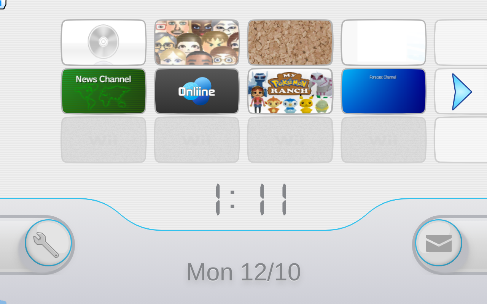
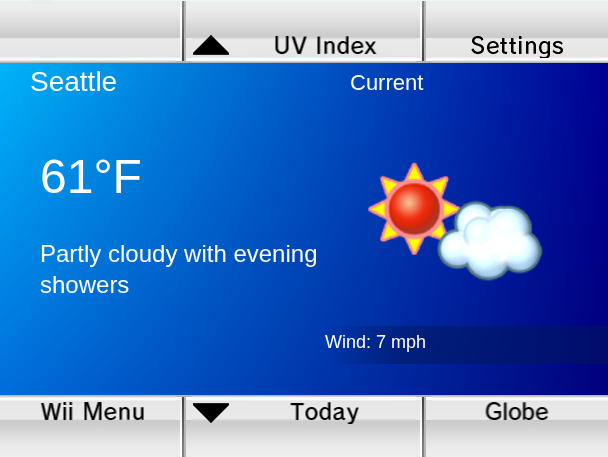
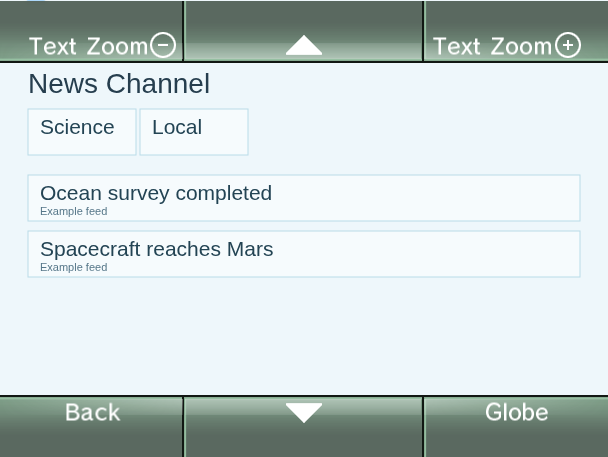

# Forecast and News application preview

Open WiiShowcase with `?screen=menu&nativeApps=1` to add Forecast and route
Forecast/News Start buttons to the shared application adapter. The normal menu
keeps its existing seven channels and News reader. Application ZIPs load only
when Start is pressed; closing and reopening reuse decoded resources and state.

The application toolbar accepts a JSON provider snapshot, offers explicitly
labelled example data, selects views, and saves settings in browser storage.
Pointer and companion-controller A/B inputs operate the canvas. Changes to
weather/news data update the corresponding menu banner/icon through the same
adapter. These are host data interfaces; example data is not a live feed.

Forecast uses 22 original application layouts and News uses 15. Bitmap fonts,
textures and Forecast icon layers come from the supplied WADs. The application
view renderer caches static screen variants and removes listeners on close.
The original 3D globe is currently a host marker projection. Native executables,
animated transitions, application audio, WC24 feeds and console storage services
remain outside this adapter.

The full input contract, verified flags and native input mappings are documented
in [the shared interface guide](../wewad/docs/channel-applications.md). The
complete shopping archive audit found no WADs, including inside 1,146 distinct
nested ZIPs; [the report](../wewad/docs/channel-applications/shopping-archive-audit.json)
records all archive checks. All seven separate Drive WADs passed 112 Canvas/WebGL
banner/icon frame checks.

Build before running the browser regression:

```sh
npm run build
SMOKE_CHROMIUM=/usr/bin/chromium CHANNEL_ARTIFACTS=docs/channel-applications npm run test:native-apps
SMOKE_CHROMIUM=/usr/bin/chromium npm run test:channel-loading
```

The opt-in regression checks all eight menu channels, lazy application starts,
original resources, native button masks, restrictions, live menu updates, cache
reuse and reopening. The default-menu regression checks all seven channels under
normal loading, delayed responses with 4× CPU throttling, rapid switching and
Canvas fallback. [Application results](channel-applications/results.json).

The final default-menu run became ready in 1,901 ms normally, 4,044 ms with
750 ms response delays and 4× CPU throttling, and 1,112 ms with Canvas fallback.
These are headless Chromium measurements on the shared host, with the application
regression running concurrently; they are not hardware FPS measurements. GPU
thumbnail preference and deferred app loading reduce work, while Ranch
initialization and Disc reflection rendering remain performance targets.
[Loading measurements](channel-loading-audit/application-regression/loading-results.json).






