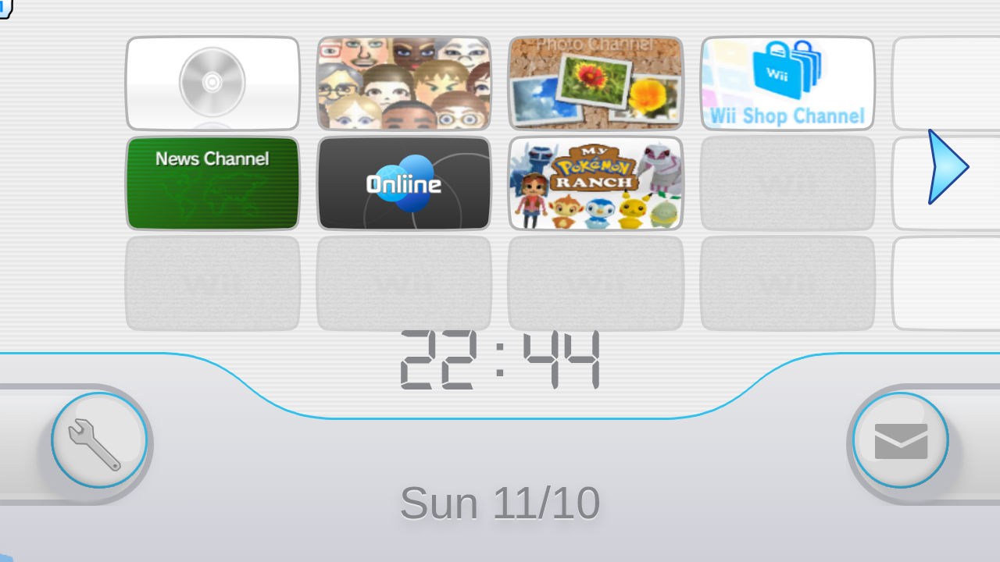
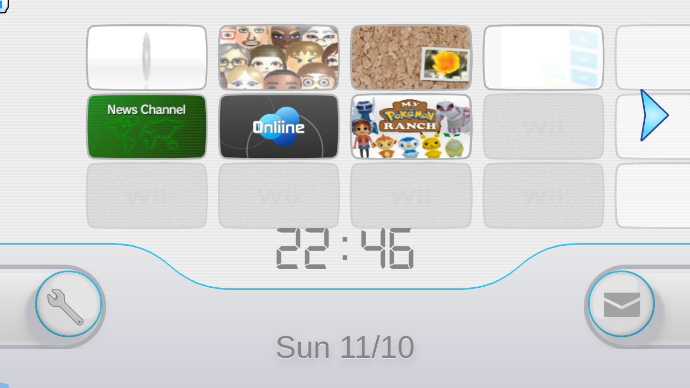
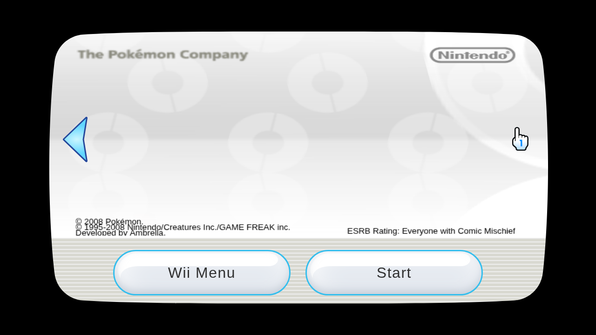

# Wewad reference compatibility and WiiShowcase channel loading

Tested October 11–12, 2026. Sources: the supplied Google Drive folder, Wewad at
`c2089bc`, and WiiShowcase at `21fdf70`, with the local changes described below.

## Results

The subsequent [outside-channel integration](channel-presentation.md) adds an
independent live input path, correct News banner aspect handling, automatic Shop
banner fallback and four eight-channel banner/icon scenarios. It opens no native
application views; the earlier application preview remains separate.

All seven supplied reference WADs passed parsing, browser rendering, and renderer
bundle export/reload. The complete 3,729,348,845-byte shopping ZIP was also
CRC-checked recursively: 621,972 file instances and 1,146 distinct nested ZIPs,
including extensionless manuals/assets under `oss/ccs`. No WADs were found and
there were no integrity errors. Filename-only inspection had missed those nested
ZIPs. The shopping React website has separate image/markup defects described
below. See [application integration](channel-applications.md) for the new
Forecast/News adapters and the complete archive report.

| Reference | Title ID | Banner textures | Icon textures | Parser warnings/errors |
| --- | --- | ---: | ---: | ---: |
| Forecast Channel (USA), v7 | HAFE | 23 | 14 | 0 |
| News Channel (USA), v7 | HAGE | 22 | 12 | 0 |
| Wii Shop Channel (World), v20 | HABA | 41 | 12 | 0 |
| Grill-Off with Ultra Hand! (USA) | WUHE | 17 | 5 | 0 |
| Dr. Mario Online Rx (USA), v256 | WDME | 13 | 4 | 0 |
| World of Goo (USA) | WGOE | 9 | 9 | 0 |
| My Pokémon Ranch (USA), v256 | WBME | 25 | 10 | 0 |

For every WAD:

- Parsed banner/icon panes, RGBA texture lengths, animation entries, and decoded
  audio samples were checked.
- Banner and icon rendered at frames 0, 30, 120, and 240 in both Canvas and
  WebGL: 112 frame checks, all with visible pixels and no render exceptions.
- Exported renderer bundles reloaded through the module worker with matching
  pane and texture counts. Icon-only reloads omitted banner and audio data.

These checks establish loading and rendering compatibility. Visual defects remain
as documented below. They do not assert
pixel identity with original Wii hardware. Forecast and News use dynamic states;
their default animations do not represent every live channel state. The Drive
folder's OTF fonts, SVG/Illustrator artwork, screenshots, and `.miic` files were
inventoried, but are outside Wewad's WAD/ARC/renderer-bundle input formats.

## Visual review and screenshots

After the initial automated checks, screenshots were visually inspected and the
actual Wewad file picker, Play/Pause controls, frame selection, and Canvas/WebGL
switch were exercised for Forecast, Wii Shop, and News. WiiShowcase's menu and
Shop selection screen were captured as well.

The original Forecast default at banner frame 16 showed overlapping weather
symbols and empty city/telop text in both backends. The subsequent Forecast input
adapter now selects data/no-data pane branches and temperature atlas cells using
an explicit weather snapshot. The original failing capture below remains useful
as a baseline; the current Forecast tests and application guide contain updated
captures. Frame-zero screenshots alone would have missed that defect.

The archived shopping website's title-detail screenshot confirms broken thumbnail,
Top/Help, rating, and bottom-button images. Title markup is printed literally and
the long controller HTML is printed across the details, causing severe overlap.
These are visible defects even though the page has no uncaught JavaScript error.

Screenshots:

- [Forecast in Wewad at frame 16](channel-loading-audit/forecast-ui.png)
- [Broken shopping title-detail page](channel-loading-audit/shopping-broken-detail.png)
- [WiiShowcase menu](channel-loading-audit/showcase-menu.png)
- [WiiShowcase Shop selection](channel-loading-audit/showcase-shop.png)

Raw comparison captures for all seven WADs remain in
`/workspace/scratch/channel-audit/wad-0.png` through `wad-6.png`; Canvas and
WebGL captures are shown in sequence in each image. Their presence does not
constitute verification against original hardware screenshots.

## Channel-loading fixes

The original worker waited for each download to finish and decode before starting
the next download. It now starts downloads when requests arrive while keeping
decoding serial. Banner requests use a higher queue priority; an active request
finishes before the next queued request is selected.

Failed download and decoded-bundle promises are removed from their caches so a
subsequent request can retry. Failed audio promises are removed too.

Automatic idle loading of every icon's banner was removed. Opening a channel
decodes its banner and audio on demand; previously scheduled warmups could retain
data for channels never opened. Successfully decoded banners remain cached for
reopening. The first open now pays the banner decode cost.

Channel selection stops old audio immediately when changing channels. Async audio
completion is ignored after switching, hiding, or unmounting the selection screen.
Audio-load failures are caught instead of becoming unhandled promise rejections.

The renderer changes are present in both `/workspace/wewad` and WiiShowcase's
`wewad` submodule checkout. These are local edits. Publishing requires committing
the renderer in its repository and updating WiiShowcase's submodule reference.

## Loading measurements

Real channel ZIPs were loaded in Chromium, with an added 500 ms delay on each
HTTP response. A fresh browser was used for each version. This isolates the
download-queue behavior from the menu's rendering costs.

| Measurement | Original | Updated |
| --- | ---: | ---: |
| Six menu icons decoded | 3,781 ms | 1,064 ms |
| First icon decoded | 999 ms | 664 ms |

Total loading time decreased about 72% in this simulated-latency run. This is not
a claim of a 72% improvement to local startup or frame rate. CPU-throttled menu
runs still showed long main-thread tasks when creating and drawing renderers.
The updated run did not improve the measured local menu/selection timings.

Next renderer work should target first-frame preparation, especially Pokémon
Ranch. In an unthrottled software-rendering run, its Canvas first draw took about
153 ms for the icon and 227 ms for the banner, while later sampled draws were
roughly 1–5 ms. A 4× CPU-throttled menu run produced an approximately 1.2-second
task around the Ranch renderer becoming ready. These measurements are from a
headless software-rendering environment, not a hardware-GPU benchmark.

Existing worker decoding, separate target caches, off-screen playback suspension,
icon frame-rate/DPR caps, shared blank rendering, and audio reuse were retained.
For a much larger channel library, bound the successful decoded/ZIP caches and
audio object URLs; the current caches retain successfully visited channels.

## Shopping ZIP findings

The 3,729,348,845-byte ZIP contains 88,106 entries, including dependencies and
macOS metadata. The complete central directory was inspected. Relevant source,
catalog, built assets, and requested browser resources were extracted using
byte ranges and validated against their ZIP CRCs. The full archive was not
extracted and every image binary was not decoded.

The catalog has 8,080 records covering 2,580 unique title IDs. Its thumbnails
are extensionless files such as `FFFD0001`; sampled files are GIF images, not
WAD resources. Thumbnail reference checks cover every catalog record.

| Asset folder | Catalog records with missing thumbnail paths | Unique missing paths |
| --- | ---: | ---: |
| Original `oss/ccs` | 138 | 124 |
| `public/oss/ccs` | 3,279 | 1,258 |
| Archived `dist/oss/ccs` | 3,279 | 1,258 |

Those counts are missing references, not counts of corrupt or decoded images.
Many records share a thumbnail path. In the US catalog alone, 357 records refer
to thumbnails missing from `public`/`dist`.

Ten routes were opened in the archived website: splash, shop, catalog, settings,
and searches/details for World of Goo, Dr. Mario, and Grill-Off. No uncaught page
errors occurred, but nine routes had broken image requests. Shared assets such as
`top_L.gif`, `help_L.gif`, `underButton_Blue.gif`, and `ESRB_E.gif` are absent
from the ZIP. Grill-Off's selected `FFFD0002` thumbnail is also absent from the
archived public/build assets. The website renders encoded title markup as literal
text, for example `Dr. Mario<sup>&reg;</sup> Online Rx`.

The lazy-loaded catalog chunk is 9,171,101 bytes before HTTP compression. It
contains the full catalog, including long controller HTML and download metadata.
For integration, split the catalog by region, serve only fields used by the
current view, move detail-only metadata to separate requests, and restore missing
UI/thumbnail assets. The shopping website currently uses absolute root paths;
embedding under WiiShowcase's `/wiishowcase/` base would require a base-path or
separate-origin plan. It has not been integrated into WiiShowcase by this change.

## Verification and repeatable commands

- Wewad: 56 unit tests passed, including four new worker scheduling/retry tests.
- Seven reference WADs passed the new `test:references` command.
- Seven browser export/reload checks passed.
- WiiShowcase: production build and production browser smoke test passed.
- New audio regression command passed stale-channel completion, immediate stop,
  and hide-before-completion scenarios with controlled deferred bundle loads.
- Both repository builds passed. WiiShowcase still reports its existing large
  Mii runtime chunk and browser-externalized Node dependency warnings.

```sh
cd /workspace/wewad
npm test
npm run test:references -- /workspace/attachments /workspace/scratch/channel-audit/goo.wad
npm run build

cd /workspace/wiishowcase
npm run build
SMOKE_CHROMIUM=/usr/bin/chromium npm run test:smoke
SMOKE_CHROMIUM=/usr/bin/chromium npm run test:channel-audio
```

The reference command requires local copies of the supplied WADs; binaries are
not committed. Evidence summaries are in `channel-loading-audit/` beside this
report. Full session measurements and screenshots remain in
`/workspace/scratch/channel-audit`.

## Forecast follow-up

Forecast's overlapping raw banner has since been repaired in the shared renderer
checkout. It now chooses one no-data message, selects custom weather layers, and
uses the USA v7 native temperature atlas. Bundle settings carry weather through
export/reload. The matching-version decompilation and WiiLink file generator were
also reviewed; the full application/globe remains separate from banner rendering.

The detailed investigation, screenshots and integration steps are in
`/workspace/wewad/docs/forecast-channel.md`. Forecast still needs a menu entry,
exported bundle and Start-screen destination in WiiShowcase.

## Full-menu and selection-group follow-up

The production-build browser test `npm run test:channel-loading` now waits for
**all seven current selectable channels**: Disc, Mii, Photo, Shop, News, Onliine,
and Pokémon Ranch. It checks all six decoded menu canvases and the Onliine image,
plus one shared blank-channel decode. Forecast is not registered in this menu.

Scenarios exercised:

- Fresh full-menu load, then the Disc/Mii/Photo, Shop/News/Onliine, and Ranch
  selection groups. All menu channels remain mounted during these opens.
- Reopen all seven selections in the same page. No repeated bundle decode.
- Full menu with 750 ms ZIP response delay and 4× CPU throttling, then the
  Mii/Shop/Ranch subset.
- Rapid cold navigation across all selections while icons/banners are loading,
  ending on Ranch. The final audio's SHA-256 matches the Ranch bundle, and the
  banner identifies the same channel.
- Full menu with WebGL disabled. Disc and Shop use their Canvas fallback.

The latest run passed with no console errors, uncaught exceptions, failed
requests or loader-worker errors. After the targeted thumbnail and hidden-app
changes, full-menu readiness was 1,156 ms normally, 3,296 ms in the delayed/4×
CPU case, and 1,128 ms with WebGL disabled. Fresh banner opens were 396–683 ms.
The slow heavy subset took 1,653–2,088 ms. These are local headless Chromium measurements, not
physical Wii timings or a guarantee for every device. The slow run still had a
851 ms main-thread long task while initializing Ranch, so expensive renderer
initialization remains a performance target. Tests cover menu/selection loading
and News Start/return; the other Start destinations were not exercised.
The final evidence is `performance/loading-results.json`.

The broader test exposed a Mii avatar failure that the menu-only smoke test
missed. The primitives entry point eagerly evaluated runtime-dependent NW4R
scene exports, throwing before Three's runtime initialized. In the local
`miicreateor` dependency, a new `miicreator/images` entry point exposes image
primitives without those scene imports. Explicit FFL resource configuration is
also honored before the compositor's default loader runs. WiiShowcase uses
that entry point and serves/copies `FFLResHigh.dat` under its configured base
path. The production test verifies a decoded 512-pixel Mii avatar. An inert
favicon removes the unrelated missing-default-favicon request.

[Full machine-readable results](channel-loading-audit/full-menu/loading-results.json).







Reproduce after building:

```sh
npm run build
SMOKE_CHROMIUM=/path/to/chromium npm run test:channel-loading
```

Set `CHANNEL_ARTIFACTS` to choose the screenshot/JSON directory. The Mii avatar
check needs the local `miicreateor` package and its FFL resource. Changes span
WeWAD, WiiShowcase's renderer submodule checkout, and that local Mii dependency.

### Hidden application work and continuous menu cost

The message board previously created Mii avatars while hidden, loading its
runtime, FFL resource, and supporting modules during channel-menu startup.
The hidden News iframe also booted Angular and ran its clock. Both now wait
until their first visible open. They stay mounted afterward, preserving board
state, generated avatar URLs, and the News reader's state on subsequent opens.

An isolated production comparison used the same renderer/app sources with only
these two deferrals reverted for the baseline. In Chromium at 1280×720 without
CPU throttling, over startup plus 15 seconds after all six decoded channel icons
were ready, the baseline fetched **6,615,154 decoded bytes** for the hidden Mii
and News applications; the updated menu fetched zero of these resources.
The sampled long-task count fell from 70 to 10 and the largest task from 348 ms
to 197 ms. Icon readiness was effectively unchanged: 1,034 versus 1,024 ms.
These are single-run measurements, not a stable FPS or latency guarantee.
The resource cost is deferred to the first actual Mail/News open.
Evidence: `performance/hidden-app-comparison.json`.

Separately, five seconds of development-renderer frame instrumentation measured
Canvas icon redraws with all channels visible. Shop averaged 15.0 ms per redraw
(p95 25.0 ms), Disc 9.1 ms (p95 12.7 ms), shared blank 2.9 ms, News 1.9 ms,
Ranch 0.9 ms, Photo 0.5 ms, and Mii 0.3 ms. The CPU sample profile identified
per-pixel TEV evaluation as the dominant work. Those costs are renderer JavaScript
execution, not the browser's presented-frame rate; initialization and iframe work
were excluded from this particular frame measurement. Evidence:
`performance/menu-frame-costs.json`.

These baseline observations motivated the targeted GPU preference described
below. The pre-optimization loading test observed a 1,011 ms main-thread task at
four-times CPU slowdown. Menu renderers already pause behind a selected channel
or Mail, and the final run still exposes Ranch's one-time initialization cost.

Validation covered all seven menu channels and selection groups, warm decode
reuse, 750 ms ZIP delay at four-times CPU slowdown, and rapid cold selection.
Additional browser checks verified first-open Mii rendering, avatar reuse on
Mail reopen, lazy News Start, and its Wii Menu return. These checks are included
in `test:channel-loading`.

### Targeted GPU thumbnail preference

Disc and Shop thumbnails now prefer accurate WebGL when supported, with the
existing `auto` backend selecting Canvas when WebGL is unavailable. Their native
animations and pane visibility are retained. This change follows a comparison
of actual bundle/settings output at frames 0, 30, 120, 240, 480, and 960.
Mean absolute channel error remained below 0.58 on the 0–255 scale; at most 1.94%
of pixels differed by more than eight channel values. Review of the screenshot
grid showed small edge/sampling differences without missing artwork. Both GPU
contexts returned `NO_ERROR`, with no browser errors.

At four-times CPU slowdown, the isolated renderer timing windows were:

| Thumbnail | Source frames | Canvas mean | WebGL mean |
| --- | --- | ---: | ---: |
| Disc | 0–177 | 37.19 ms | 26.93 ms |
| Disc | 240–417 | 5.81 ms | 0.54 ms |
| Disc | 720–897 | 5.64 ms | 0.39 ms |
| Shop | 0–177 | 62.08 ms | 3.75 ms |
| Shop | 240–417 | 56.20 ms | 3.46 ms |
| Shop | 720–897 | 2.28 ms | 2.74 ms |

These measure synchronous renderer execution in headless Chromium using
software WebGL, not physical display FPS or GPU execution time. Shader startup
adds a one-time cost; Canvas also benefits from cached materials later in the
native animation. The whole-menu comparison therefore remains useful alongside
these isolated timings. In one five-second window after all channels loaded at
four-times CPU slowdown, the Canvas baseline's average rAF callback interval was
217.9 ms versus 58.4 ms with the two GPU thumbnails; total main-thread long-task
time was 4,844 versus 2,637 ms. Shared-host scheduling and animation phase can
change these single-run results. See `performance/gpu-thumbnail-menu-comparison.json`.

Reproduce the output comparison and isolated timing with:

```sh
SMOKE_CHROMIUM=/usr/bin/chromium \
CHANNEL_ARTIFACTS=/tmp/showcase-thumbnail-profile \
npm run profile:thumbnails
```

`CHANNEL_CPU_SLOWDOWN` defaults to four. The profiler creates an isolated Vite
page and does not modify production settings. Evidence and comparison grid are
in `performance/backend-comparison-actual/`.

The loading test additionally checks the entire menu with WebGL disabled and
asserts that both targeted thumbnails render through Canvas. Disc's remaining
introductory reflection work and Ranch's one-time initialization remain the next
CPU targets. The earlier Canvas-only menu timing describes the baseline, before
this preference was applied.
