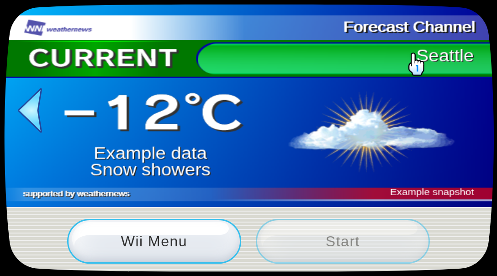
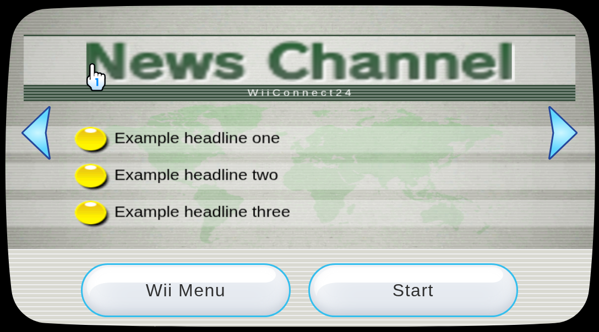
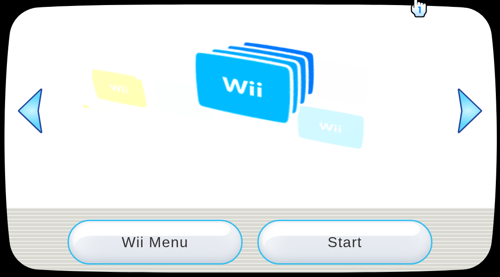

# Banner and icon integration

Open `?screen=menu&channelPreview=1` to inspect the eight-channel menu and Forecast
banner/icon without opening its application. Forecast's Start is disabled. Live
weather, News and generic pane/locale inputs now have an independent store in
`src/lib/channelPresentation.js`; they are not tied to the application preview.

The [shared outside-channel guide](../wewad/docs/banner-icon-interface.md) covers
the provider event/API, verified view/flag mappings, target-specific controls,
Shop intro override and export/reload. Application work stays separate.

News banners now follow the selected aspect ratio, fixing cropped headings in
widescreen. Shop banners prefer the automatic GPU backend with Canvas fallback.
News uses its long ticker loop instead of the short banner intro, so headlines
continue moving and state changes preserve their current frame.
Updating data preserves the mounted renderer and decoded assets. Icons decode at
startup; banners/audio remain deferred until selection. Disc/Shop thumbnails keep
the previously measured GPU preference. Ranch initialization and Disc reflections
remain performance targets; [profiling evidence](channel-loading-audit.md).

The production browser test loads all eight channels under normal, 4:3, Canvas
fallback and 750 ms response-delay/4× CPU conditions. It verifies live icon/banner
updates, invalid-update atomicity, Forecast and News fallback changes, Shop pane
override/reset and zero application downloads. [Results](channel-presentation/results.json).
The measurements are headless Chromium on the shared host, not Wii/display FPS.

```sh
npm run build
SMOKE_CHROMIUM=/usr/bin/chromium CHANNEL_ARTIFACTS=docs/channel-presentation npm run test:channel-presentation
SMOKE_CHROMIUM=/usr/bin/chromium npm run test:channel-loading
SMOKE_CHROMIUM=/usr/bin/chromium npm run test:channel-audio
```

Forecast banner with example data:



News banner with example headlines:



Shop banner with its optional intro override:



## Final loading measurements

| Menu scenario | Time to all icons ready |
| --- | ---: |
| Eight channels, normal | 1,566 ms |
| Eight channels, four-three | 1,123 ms |
| Eight channels, canvas-fallback | 1,128 ms |
| Eight channels, slow | 3,563 ms |

The delayed scenario adds 750 ms to ZIP responses and applies 4× CPU throttling.
These single runs measure loading on the shared host, with other browser checks
running concurrently. They do not measure physical display FPS.

[Default seven-channel results](channel-loading-audit/banner-icon-regression/loading-results.json)
include warm reopen, slow loading, rapid switching and Canvas fallback.
