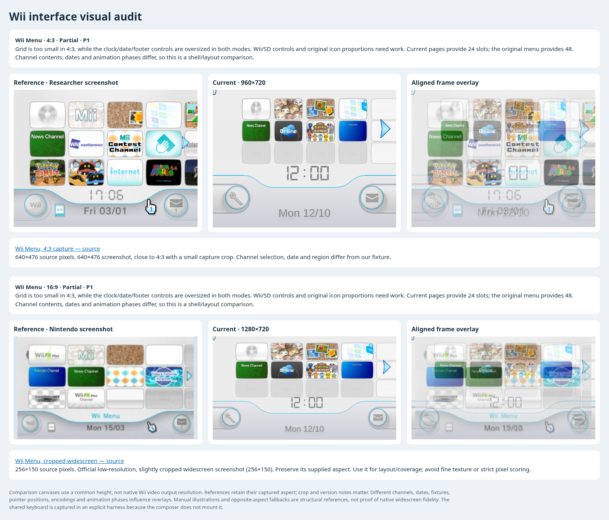
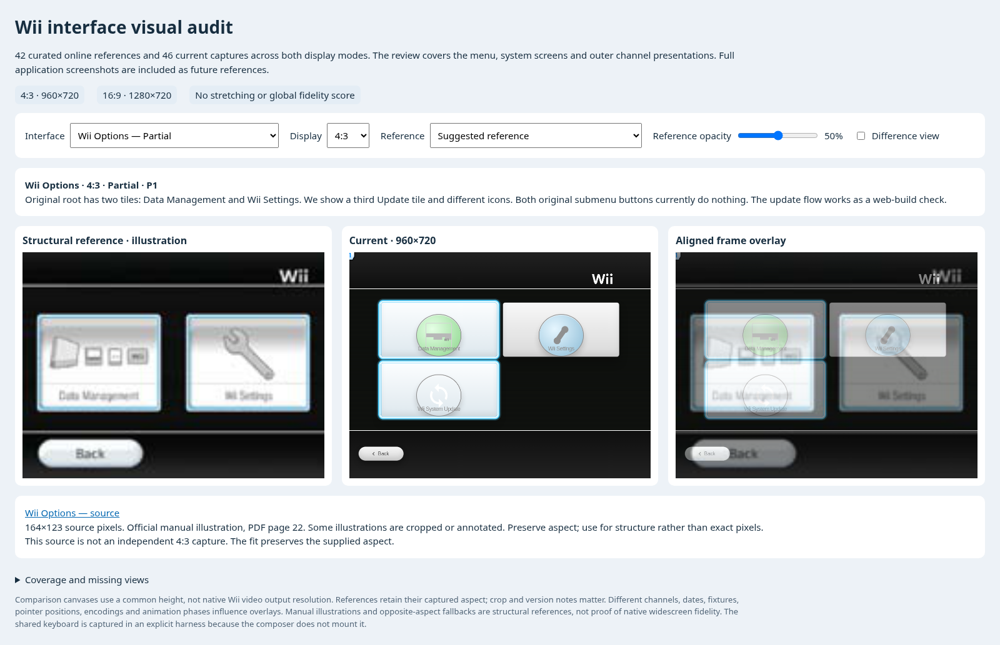

# Wii interface audit in 4:3 and 16:9

The menu and native channel previews are functioning, but the system interface
still has substantial differences in proportions and navigation. The largest
visual mismatch is the menu's grid/footer balance. The largest functional gaps
are the Settings/Data Management submenus, message composition and HOME's remote
settings.

The [interactive viewer](interface-audit/index.html) contains **42 curated online
references and 46 current captures**, with opacity and difference controls. This
includes 44 full-pass captures plus two Options display-size spot-checks. Its 45
review entries catalogue implemented states, adaptations, missing default views
and full-application references. Some entries cover different states or sizes of
the same interface; this is not an exhaustive count of every Wii application screen.

The full pass captured every selected state at **960×720 (4:3)** and **1280×720 (16:9)**.
Options was additionally checked at **640×480** and **854×480**. All six tile
centers hit the intended buttons and their bounds fit the frames; the original
two-tile layout remains different. These are logical display-size checks, not
claims about the console's raw anamorphic framebuffer.
These use the same comparison height; they do not describe native Wii output
resolution. Source images retain their supplied aspect and use centered contain
fitting. A 4:3 image is never stretched into a widescreen reference. The viewer
labels manual illustrations, crop/region/version differences, opposite-aspect
fallbacks and missing references. It calculates no global accuracy percentage:
channel contents, fixtures, dates, cursors and animation phases are not identical.

| Area | Current state | Difference or missing capability | Priority |
| --- | --- | --- | --- |
| Wii Menu layout | Eight-channel presentation preview loads in both modes | 4:3 grid too small; clock/date/footer controls too large; footer curve and Wii/SD controls differ | P1 |
| Menu contents/navigation | Two pages, 24 slots | Original menu has four pages/48 slots, channel rearrangement and SD entry | P1/P2 |
| Wii Options | Three drawn tiles; web Update works | Original root has two tiles; icons/labels differ. Data Management and Wii Settings do not open | P1 |
| Settings and Data Management | Root entry points only | Three settings pages, nickname/date/time/display/sound controls, save/channel grids and storage actions are not wired | P1 |
| Message board | Sample letters, day navigation, read pins and Mii images work | Compose/Address Book are missing. Sample data does not demonstrate posting or message storage. Footer/card proportions differ | P1 |
| Opened memo/letters | Displays sample content; outside click dismisses | Back/delete controls are absent; received-letter Reply and photo actions are missing | P1 |
| Calendar | Month navigation and message indicators work | Margins, arrows, Back control and text scale need calibration | P2 |
| HOME | Opens/closes and offers Menu/Reset | Bar/button proportions differ; remote graphic extends below the frame; Remote Settings has no controls; battery display represents connection state | P1 |
| Shared keyboard | Basic Shop-style input works | Not mounted by the Showcase composer. Original system profile needs language/symbol controls, alternate layout and multiline/return/scroll controls | P1 |
| Native icons/banner shells | Captured Disc/Mii/Photo/Shop/News/Ranch/Forecast | Matching title/input/animation frames are needed to assess art fidelity. Several Start buttons have no destination; Forecast preview is opt-in and disabled for Start | Coverage limitation |
| Full Shop/Mii/Photo/Forecast/News applications | Separate projects and/or opt-in previews exist | Their runtime fidelity is not demonstrated by native banner adapters. Full-application screenshots are collected as future references | Separate pass |
| Safety/update/pairing | Web-specific flows | Mouse hint, build updater and browser pairing are adaptations; they should not be graded as literal console services | Adapted |



The menu's first row provides comparable Disc/Mii/Photo/Shop positions, but the
fixture's remaining channels differ. The native resources animate, so appearance
of an individual icon in a still image is not by itself a missing-texture finding.
Both initial and four-seconds-after-ready menu captures are retained. The original
4:3 screenshot has a small height crop, and Nintendo's widescreen image is small
and slightly cropped; the overlay is suitable for proportion review, not precise
texture scoring.



The navigation findings were confirmed with actual clicks in **both modes**:
Data Management and Wii Settings remain on the root; Notepad does not open a
composer; Wii Remote Settings does not expose volume/rumble/reconnect controls;
Shop Start remains on its selection screen. These observations agree with the
source: [WiiSettings.jsx](../src/components/WiiSettings.jsx#L41) only binds Update,
[WiiMenu.jsx](../src/components/WiiMenu.jsx#L419) draws Notepad without a handler,
[HomeMenu.jsx](../src/components/HomeMenu.jsx#L88) renders Remote Settings as text,
and [App.jsx](../src/App.jsx#L414) starts only configured actions/targets.

The original keyboard and the supplied Shop website are different profiles.
Nintendo's system keyboard supports letter/symbol shifting, language selection,
an alternate phone-style layout and message-board-specific predictions. Our
persistent uppercase Shift intentionally follows the requested **Shop website**
behavior. Add an explicit system profile while preserving that choice. The shared
component's real keyboard/touch/audio checks remain useful, but they do not prove
the complete original system keyboard is reproduced. [main.jsx](../src/main.jsx#L4)
does not register/mount a keyboard for the composer; the audit's keyboard shot
explicitly loads the shared component as a standalone harness.

The next work should be:

1. Establish menu/system layout constants for both display modes, then align the
   grid, footer curve, clock, date, buttons and text metrics against matched
   references. Keep native banner content separate from this surrounding layout.
2. Wire Wii Options to the three settings pages and Data Management. Align its
   two root tiles and connect the existing web updater through the appropriate
   settings entry.
3. Implement composer/Address Book and letter actions, using a message model and
   the shared keyboard. Add the original system keyboard profile rather than
   changing the chosen Shop behavior globally.
4. Implement HOME remote-setting controls and context-dependent states/guide
   support. Define battery/volume/rumble inputs independently from connection
   status and preserve the browser pairing adaptation.
5. Expand the menu model to 48 slots, persistent layout/rearrangement and SD
   views. Continue full applications in a separate pass with their view/input
   adapters, matching original runtime states and assets.

Primary visual sources are [Nintendo's Wii Channels & Settings manual](https://csassets.nintendo.com/noaext/image/private/t_KA_PDF/WiiChEng)
and [Nintendo's Wii Menu page](https://www.nintendo.com/en-gb/Wii/Wii-Channels/Wii-Menu/Wii-Menu-749371.html).
Additional published captures come from [Rodrigo Copetti's analysis](https://www.copetti.org/writings/consoles/wii/),
[Nintendo World Report's gallery](https://www.nintendoworldreport.com/media/12082/1)
and [Wii Hacks Guide's system-settings screenshot](https://wii.hacks.guide/letterbomb).
Each reference has its URL, original dimensions, source hash and limitations in
[references.json](interface-audit/references.json). A disputed Reddit aspect pair
and corrupted-Disc state were excluded; an unavailable safety image and old
Nintendo 404 links are recorded rather than treated as validated images.

[Current capture/interaction results](interface-audit/current-results.json),
[combined audit](interface-audit/audit.json) and
[viewer validation](interface-audit/viewer-validation.json) are retained. Capture
time is fixed for reproducibility. All 90 viewer entry/display combinations load
their images and its opacity/difference controls pass. The local browser capture
reported no uncaught page exceptions or failed resource responses. Screenshot
comparisons do not establish motion/audio timing, network-service behavior or
fidelity of applications not launched in this pass.

To refresh current captures and the viewer:

```sh
npm run build
# Run in another terminal:
node node_modules/vite/bin/vite.js preview --port 4950 --strictPort
SMOKE_CHROMIUM=/usr/bin/chromium node scripts/capture-interface-audit.mjs
SMOKE_CHROMIUM=/usr/bin/chromium node scripts/check-interface-native-sizes.mjs
node scripts/build-interface-audit.mjs
python -m http.server 4953 --directory docs/interface-audit
```
