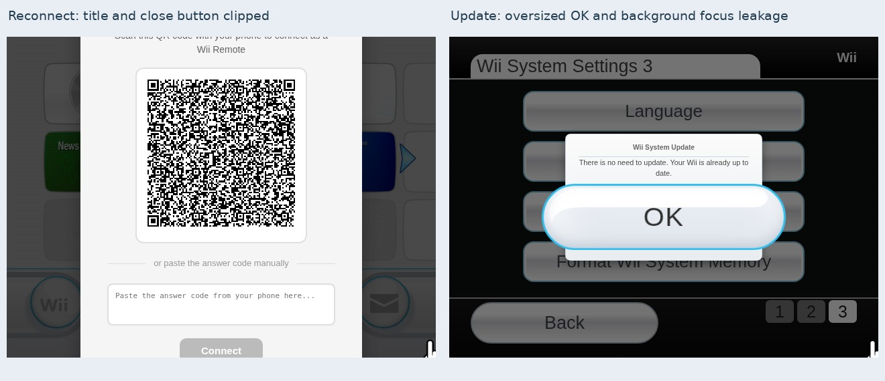
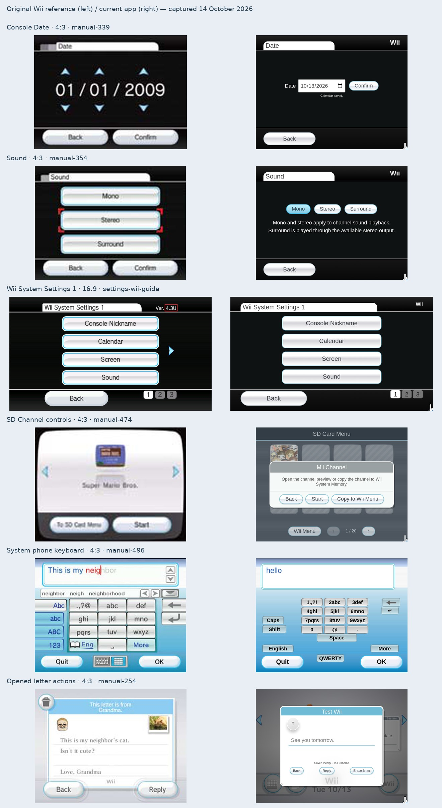

# Other Wii menus: current audit

[Open the comparison viewer](other-menus/) for every captured screen, both aspect
ratios, 480/720-line sizes, reference opacity and difference controls.

This pass inspected **54 system destinations and primary dialog/input states** in
**216 actual application captures** at 640×480, 854×480, 960×720 and 1280×720.
It audits the implementation at `f198c02`, following the shared menu-registry work.
The UI has not been corrected by this audit. Full channel applications and the
already-audited Wii Menu grid are outside this pass.

## Actual breakages found

| Priority | Screen                       | Reproduced problem                                                                                                                                                                                                                                                                           |
| -------- | ---------------------------- | -------------------------------------------------------------------------------------------------------------------------------------------------------------------------------------------------------------------------------------------------------------------------------------------- |
| P1       | Reconnect                    | At both 480-line sizes, the close button begins around **y=-79**; the card's title is cut off. The card fits in the two 720-line captures.                                                                                                                                                   |
| P1       | Operations Guide             | In 4:3, the Remote Settings footer button begins around **y=476** at 480 lines and **y=714** at 720 lines, extending below the screen and failing its center hit. Both wide captures fit.                                                                                                    |
| P1       | System Update                | The 640×480 result panel has an **OK button wider than its dialog** and tiny title/body text. It mixes viewport dimensions with the shared button's different scale.                                                                                                                         |
| P1       | System Update keyboard focus | Opening the overlay leaves focus on the background Settings button. Tab reaches Format, page buttons and Back. Escape changes the background path to Options while Update remains open. The overlay has no dialog role or inert background.                                                  |
| P1       | Automatic pairing relay      | Local preview returned four HTTP 404s while polling its own pairing sessions. A read-only check of the production origin endpoint also returned HTML/404. The client expects JSON from `/api/signal/<session>`. Actual two-device, manual-code and BroadcastChannel pairing were not tested. |

[Update focus reproduction](other-menus/update-focus.json),
[relay check](other-menus/relay-check.json), and
[raw additional captures/checks](other-menus/additional-captures.json) retain the
evidence. Raw pointer findings also include background controls covered by the
custom overlays. Those are grouped with modal isolation; they are not presented
as dozens of separate visible-control bugs.

## What still differs visually

| Area                                            | Main gaps                                                                                                                                                                                                                                                                                                                   |
| ----------------------------------------------- | --------------------------------------------------------------------------------------------------------------------------------------------------------------------------------------------------------------------------------------------------------------------------------------------------------------------------- |
| Shared fonts                                    | Settings actually renders **Liberation Sans** in this Chromium environment at all four sizes. Rodin/NewRodin are requested but not bundled. The M PLUS date/AM/PM approximation does not cover the other menus. Metrics can therefore vary across operating systems.                                                        |
| Options / Data Management                       | Tile/icon proportions, breadcrumbs, header/footer rules, storage tabs and bevels differ. Save icons use placeholders; channel data includes the menu-only Disc item, and Forecast falls back to text. The GameCube view initially selects neither Slot A nor Slot B.                                                        |
| Settings pages 1–3                              | Native side arrows and firmware area are absent; header and Back treatment differ. In wide mode the first button's DOM box is approximately 16 logical units wider than the high-resolution source's cyan outline. The two edge definitions and source filtering introduce uncertainty.                                     |
| Date / Time                                     | Browser date/time controls replace the large digit columns and arrows. Confirm is inline rather than in a bottom action rail.                                                                                                                                                                                               |
| Nickname / Sound / display / Language / Country | Generic small/wrapping buttons replace native field or selector layouts, selection brackets and a separate Confirm action. Country has seven choices rather than a scrolling native list. Most changes save immediately, so native cancel/confirm behavior is also missing.                                                 |
| Sensor Bar / Parental / Internet / WiiConnect24 | Simplified browser forms replace much of the native hierarchy and artwork. Sensitivity uses a range input/static dots; parental controls are a limited PIN gate; Internet is an online-data toggle; standby and slot-illumination views are absent. Hardware/service limitations are separate from visible layout fidelity. |
| SD Menu                                         | Top heading, striped blanks and plain toolbar replace the sculpted native footer/page counter/navigation/help composition. Selected titles open a generic modal instead of the large native selection panel. Working 240-slot paging does not establish visual equivalence.                                                 |
| HOME / Remote Settings                          | Bar/button proportions, remote placement, utility icon and meter/row spacing differ. Filled battery bars indicate connection rather than measured charge. Operations Guide contains browser-specific instructions.                                                                                                          |
| Message Board / Calendar                        | Footer/date metrics, calendar size/margins/row proportions and action rails differ. Message inventory, dates and types do not match every source; those content differences are not scored as geometry defects.                                                                                                             |
| Memo / letters / Address Book                   | Paper/book proportions, line spacing, avatar/photo treatment, outer paging and edge actions differ. Letter composition exposes browser recipient/file controls. Registration/contact/confirmation steps have only related references in several cases.                                                                      |
| System keyboard                                 | QWERTY utility/scroll/layout-switch controls differ. The phone layout is a small central keypad instead of the reference's larger matrix and case/number rail. Suggestions work when `hel` is typed; a blank capture does not demonstrate a missing prediction feature. Shop's chosen behavior is preserved.                |

The [machine-readable audit](other-menus/audit.json) contains a specific finding
and next action for every one of the 54 states. The viewer links each to its
current captures and available source. Six additional native destinations are
listed without invented current screenshots: standby, slot illumination, parental
rating restrictions, connection profiles, user agreements and the SD memory-error flow.

## Evidence and confidence

Fifteen more original embedded illustrations were extracted from Nintendo's
official US operations manual, extending the
[source manifest](interface-audit/references.json). Their source page, dimensions
and SHA-256 are recorded. These pictures remain low resolution; extracting them
does not recover original font or pane metrics.

Settings page 1 has independent 4:3 and 16:9 captures with **4.3E** and **4.3U**
printed respectively. Those labels identify only their own screenshots. Other
bare screens are not assigned an exact firmware from their upload date or styling.
The [Settings outline measurements](other-menus/settings-outline-measurements.json)
use original source pixels and preserve aspect; they do not establish an overall
accuracy score. The 4:3 source has a four-line crop, adding framing uncertainty.

Manual, cropped, opposite-aspect and related-state images are visibly labeled.
For example, the old letter-composer comparison used a Memo reference, Channels
used Save Data, and the accent palette used normal QWERTY. These now say
**related view/state**, rather than implying a matched native screenshot. Their
overlays are structural illustrations. Intermediate Calendar/Screen/Sensor Bar
menus and the custom Operations Guide have no same-view reference collected.

## Verification and next steps

The existing regression passed **82 interaction checks**. Its 28 non-menu states
passed 112 screen/size checks. The additional 26-state pass found the clipping
cases described above, and targeted keyboard testing confirmed Update's focus
leak. No JavaScript page errors were recorded. Pairing relay 404s are retained
separately from static asset loading; no successful cross-device pairing is claimed.

Fix the P1 clipping, dialog sizing and focus behavior first. Then establish a
permitted shared font and build distinct selector/paper/book/SD adapters. Carry
the confirmed anchors, source confidence and input-state policies into the
[maintained layout reference](layout-reference/), rather than adjusting one generic
form until all screens look superficially similar. That index now includes the
additional destinations and native views without adapters.

To reproduce the audit, build the app and run `npm run capture:other-menus`.
It runs the core sizing regression in a temporary directory, collects its
non-menu captures, then captures the additional destinations. Use
`OTHER_MENU_CORE_SOURCE` with `npm run capture:other-menus:core` to collect an
existing complete sizing run. Then run `npm run build:other-menus`, `npm run build:layout` and
`npm run test:other-menu-viewer`. The browser viewer test needs the docs server
on port 4957. The capture scripts use only their own isolated browser storage;
format/erase operations do not touch the user's saved state.
