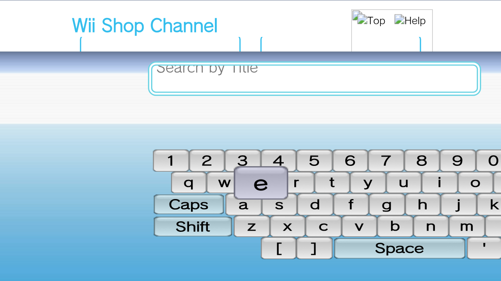
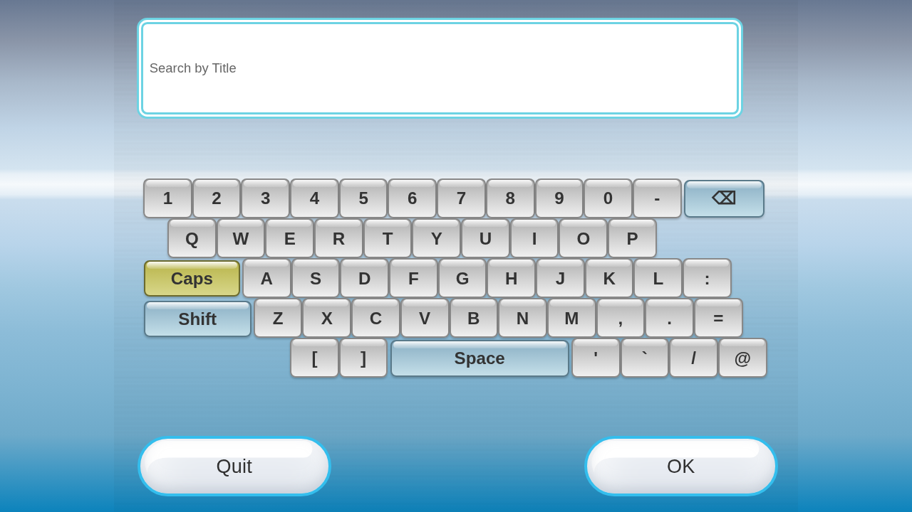

# Shop keyboard compared with Wii.css

The Shop entry in WiiShowcase currently provides a menu icon and selection banner.
Its Start button has no Shop destination. The on-screen keyboard inspected here
belongs to the separate React website supplied in `shopping.zip`.

The archive website uses `KeyboardOverlay.tsx`, a Zustand keyboard store and
`audioManager`, with image-based keys. It does not instantiate Wii.css's
`<wii-keyboard>` component. Both implement the same 53-key layout based on a
608×456 reference, but they are not behaviorally or visually identical.

## Browser comparison

The audit opened the real website's **WiiWare → Search by Game Title** keyboard
and a separately hosted Wii.css keyboard at 1280×720. It exercised Caps/Shift,
physical Right Shift, backtick, Tab, Ctrl+A, empty/nonempty backspace, Space,
Escape and Enter confirmation. It recorded media play calls and inspected
screenshots. Shift comparisons start with Caps off on both implementations.

WiiShowcase currently pins Wii.css commit `e90ea79`. Wii.css's current `main`
(`64bbb99`) has additional keyboard accessibility and asset-loading improvements.
The audit checked both revisions without changing the pin.

| Behavior/option | Shop website | Pinned Wii.css | Current Wii.css main |
| --- | --- | --- | --- |
| Key count | 53 | 53 | 53 |
| Initial letter case | Lowercase | Uppercase | Uppercase |
| On-screen Shift, then two A keys | `AA`; Caps remains enabled | `Aa` | `Aa` |
| Physical Right Shift + A, Caps initially off | `a`; Right Shift ignored | `A` | `A` |
| Physical backtick | No character; source uses `BackQuote` | Correct backtick | Correct backtick |
| Tab from input | Blocked | Blocked | Focus moves to a key; focus trap at dialog boundaries |
| Ctrl+A | Blocked | Blocked | Passed through to native input |
| Semantic controls/dialog | Div keys, no dialog role | Button keys, no dialog role | Button keys, dialog semantics and focus restoration |
| Keys extending outside 1280×720 viewport | 16, including Quit/OK | 0 | 0 |
| Pointer activation | Mousedown | Click | Click, including touch/keyboard activation |

The Shop screenshot confirms a scaling/positioning defect: its container is
scaled from a fixed top-left origin while its offsets still use unscaled 608×456
dimensions. The keyboard extends to the right and below the viewport. Wii.css's
panel scales uniformly and stays centered. The source formula and screenshot
agree; this is not a WAD renderer or texture-mask defect.

Both provide initial text, prompt text, confirm and cancel callbacks. Wii.css
also exposes open/close/confirm/cancel custom events and a configurable `sounds`
asset path. Shop's audio settings adjust global sound volume. Neither inspected
keyboard exposes a public layout/language/type selector or maximum-length option.
The `kbd_denied` sample exists but neither inspected path uses it to enforce such
an option. Enter confirmation delivered the expected input in both audits.

## Sound files match; playback policy differs

All ten `kbd_*.wav` files are **byte-for-byte identical**, confirmed with SHA-256.
The open, hover, key, Space, backspace, empty-backspace, Caps, denied, confirm-hover
and confirm samples therefore use the same recordings. Keyboard sound URLs loaded
successfully during the browser checks.

At the Shop website's default sound setting of 25%, `playKeySound` sets keyboard
volume to **0.125**. Wii.css uses **0.5**. Shop reuses one audio element per sound,
resets its time and restarts it on rapid input; Wii.css clones the element so
successive sounds overlap. Matching recordings do not make loudness, overlap or
mousedown-versus-click timing identical. The audit verifies files and playback
calls; it is not a perceptual audio or original-hardware comparison.

The shared key actions and assets could be kept consistent by adapting Shop's
store/callbacks to the shared keyboard, or by porting its verified behavior into
the React component. The Shop source was left unmodified during this comparison.

## Evidence and reproduction

[Pinned-framework results](shop-keyboard/results.json) include event observations,
clipped-key bounds, media-instance IDs, sound hashes and existing website image
failures. [Current-framework results](shop-keyboard/latest-css/results.json)
capture the newer keyboard behavior separately. Both reported zero uncaught
page exceptions and zero missing keyboard sound files. Shop's previously noted
Top/Help and footer image failures are separate from its keyboard assets.

```sh
SMOKE_CHROMIUM=/usr/bin/chromium npm run audit:shop-keyboard -- /path/to/extracted/shopping/wiishopchannel.net
# An optional second directory compares a different Wii.css checkout:
KEYBOARD_ARTIFACTS=/tmp/latest-keyboard SMOKE_CHROMIUM=/usr/bin/chromium npm run audit:shop-keyboard -- /path/to/shop /path/to/Wii.css
```

Shop keyboard:



Pinned Wii.css keyboard:


